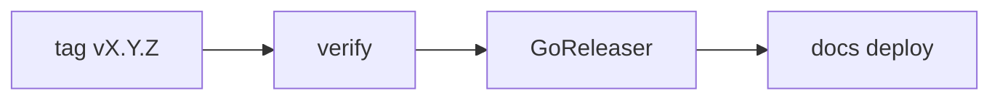

# Releases and docs

The site you are reading documents one release, and it says which one: the
version is in the banner on the home page and on the release notes. This page explains how a release is
made and why the site cannot drift from it.

## The release chain

`mise run release` tags a version; the tag starts the *Release* workflow:

1. **verify** runs tests, vet and lint, checks that the generated docs
   (screenshots, CLI samples, command reference, man pages) are up to date,
   checks that `CHANGELOG.md` has a section for the tag, and builds the site
   with `--strict`. Nothing is released if one of them fails.
2. **GoReleaser** builds the archives and the Homebrew cask, and creates the
   GitHub release. Its text is the changelog section of the tag; the list of
   commits follows below it.
3. **docs** builds the site from the tag and deploys it to GitHub Pages.

The site follows the releases: pull requests and pushes to `develop` build the
docs but never deploy them. What you read is the state of the latest release,
not of `develop`. A manual run of the *Docs* workflow redeploys the site from
the latest tag.

## The version on the site

The macro `version_banner()` in `docs_macros.py` renders the version. On a
release build the release job sets `DOCS_VERSION` from the tag (`0.8.6`) and
the banner links to the GitHub release. Anywhere else the version is
`git describe` (`0.8.5-3-gabc123`) and the banner says "development build", so
a preview of a pull request cannot be mistaken for a release. The build checks
that the banner is on the page (`scripts/docs-version-check.sh`).

## The changelog

[Release notes](../release-notes.md) is `CHANGELOG.md`, in the format of
[Keep a Changelog](https://keepachangelog.com/en/1.1.0/). Changes are written
when they are made, not after the release:

- A pull request with a user-visible change adds a line under `## [Unreleased]`
  and updates the docs pages it affects, such as the TUI tour or the
  [troubleshooting](../how-to/95-troubleshoot.md) page.
- CI fails a pull request that changes `cmd/` or non-test code in `internal/`
  without touching `CHANGELOG.md`. A change that nobody sees (a refactoring, a
  test) takes the label `no-changelog`.
- `mise run release` refuses to release when `Unreleased` is empty. Otherwise
  it renames the section to `## [X.Y.Z] - DATE`, adds a new empty `Unreleased`
  section, commits, and then tags.

## Generated parts

The TUI screenshots, the CLI output samples, the command reference and the man
pages are generated from the code (`mise run docs:generate`), and
`mise run docs:check` fails when they are stale. Hand-written pages and the
changelog are the part a check cannot write for you; that is what the
changelog rule is for.
