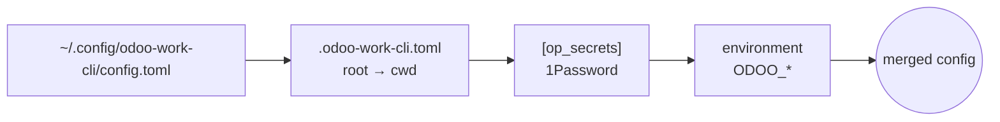

# Config layering

`odoo-work-cli` reads its configuration like `.editorconfig`: a global file,
then every `.odoo-work-cli.toml` from the filesystem root down to the current
directory, then the secrets from 1Password, then the environment. Later
layers win.

## Why layers

The same person often books for more than one context: an employer's Odoo
and a client's, or one company with several projects that need different
filters. With layers, the global file holds what is always true (your login,
the TUI keys, your federal state), and a `.odoo-work-cli.toml` in a project
directory adds what is true only there: another server, a filter on that
client's projects, other company colours. Change into the directory and the
CLI uses it; nothing to switch.

## How values merge

- **Plain values** (`url`, `bundesland`, a key binding): the later layer
  replaces the earlier one.
- **Filters** in `[models.<name>]` **accumulate**: a child file adds filters
  (AND). A child's filter on a field the parent already filters replaces the
  parent's. So a parent directory can restrict to one company and a
  subdirectory to one project of it.
- **Environment variables** win over everything, so a script or agent can
  override a single value without touching files.

`--config FILE` turns the directory walk off: only that file, then
`[op_secrets]` and the environment. Useful for tests and for the rare case
that the walk finds the wrong file.

See what you get with `odoo-work-cli config` (the files, in order) and
`odoo-work-cli config --merged` (the result, without secrets).

## Why secrets are a separate layer

Secrets never live in the files as plain text; a `password` key outside
`[op_secrets]` is rejected. The files can then be committed, shared or
pasted into an issue. See [Secrets](secrets.md).
