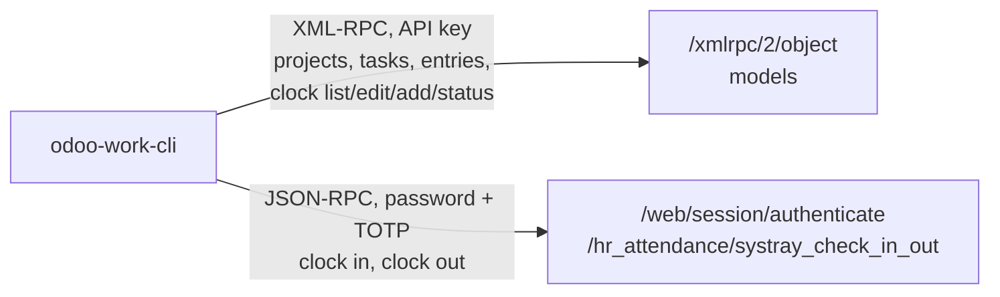

# Two transports

`odoo-work-cli` talks to Odoo in two ways. Most commands use **XML-RPC with
an API key**. `clock in` and `clock out` use a **web session with your
password**, like the browser. This page explains why.

## XML-RPC for the models

Projects, tasks, timesheet entries (`account.analytic.line`) and attendance
records (`hr.attendance`) are Odoo models. Odoo's external API reads and
writes them over XML-RPC with `execute_kw`, and the CLI uses only that
low-level API.

Odoo 17 **requires an API key** here. Your login password is not accepted,
and the failure is silent: `authenticate` returns `false` without a reason.
That is the most common setup mistake; see
[Troubleshoot](../how-to/95-troubleshoot.md).

Access rights apply as in the browser. A regular employee may read their own
attendance records, but not create or change them over the API. That needs
the *Attendance Officer* right; see
[Clock in and out → Permissions](../how-to/30-clock-in-out.md#permissions).

## A web session for clocking in and out

Clocking in and out is exactly what a regular employee may not do over
XML-RPC: it creates and changes `hr.attendance` records. In the browser it
works anyway, because the attendance button in the systray calls a
controller (`/hr_attendance/systray_check_in_out`) that acts with elevated
rights on your own behalf.

The CLI calls that same controller. A controller is not part of the external
API, so the CLI logs in like the browser: `/web/session/authenticate` over
JSON-RPC, then, with 2FA, the TOTP step, then the call with the session
cookie. That login is the exact opposite of XML-RPC: it **rejects API keys**
and wants the real password.

So `clock in` and `clock out` work for every employee, and they need the
password (and the TOTP secret). Backdating with `--at`, `clock edit` and
`clock add` cannot use the controller, which only knows "now"; they write
the model over XML-RPC and need the officer right instead.

If the session expires while the TUI is open, the CLI logs in again.

## Why not one transport

- **XML-RPC only** would leave regular employees without clock in and out.
- **The web session only** would need the password for every command and
  the TOTP step for every call, and controllers do not cover projects, tasks
  and timesheets the way the model API does.

Two transports keep the common case (reading and booking) on the API key,
and use the password only where Odoo leaves no other way.

## Version drift

The web login is not a public API; its details can change between Odoo
versions. A canary test checks the whole login flow against a development
instance before an Odoo upgrade reaches production.
