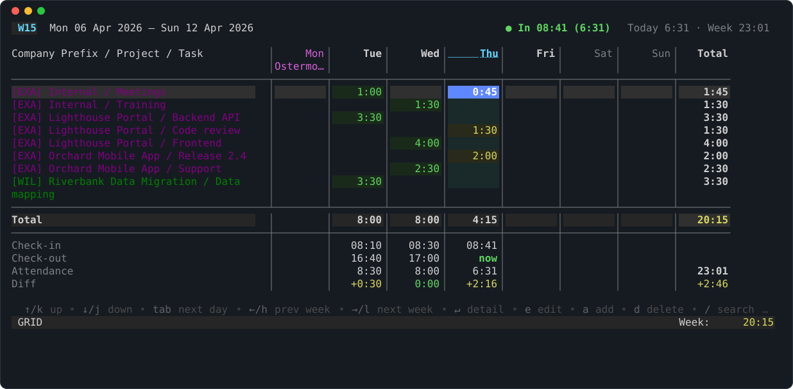

# odoo-work-cli

`odoo-work-cli` books Odoo 17 timesheets and attendance from the terminal. It
has a CLI for scripts and coding agents, with stable JSON output and error
kinds, and a TUI for the weekly grid.



*The [TUI](tutorials/30-tui-tour.md): one row per project and task, today's
column selected, attendance per day below the totals.*

## What it does

- **Timesheets.** List, add, update and delete `account.analytic.line`
  entries. `--dry-run` shows what would be written.
- **Attendance.** Clock in and out, also for regular employees and accounts
  with 2FA (TOTP). Backdate, fix or add records for a forgotten day.
- **Projects and tasks.** Search Odoo's projects and tasks to find the IDs to
  book on.
- **A contract for machines.** `--json` output follows JSON Schemas, and
  errors come as one envelope with a stable `kind`. `llm --skill` prints a
  guide for coding agents.
- **Offline.** A built-in fake backend runs every command without Odoo,
  network or 1Password. The examples and screenshots in these docs come from
  it.

## Where to start

The docs follow [Diátaxis](https://diataxis.fr/): four sections, one for each
kind of question.

<div class="grid cards" markdown>

<div markdown>
:lucide-graduation-cap:{ .lg .middle } **Tutorials**

Learn by doing. [Try it offline](tutorials/10-try-it-offline.md) without
Odoo, then [book your first entry](tutorials/20-first-booking.md) and
[take the TUI tour](tutorials/30-tui-tour.md).

[:octicons-arrow-right-24: Tutorials](tutorials/index.md)

</div>

<div markdown>
:lucide-wrench:{ .lg .middle } **How-to guides**

Recipes: [book time](how-to/20-book-time.md),
[clock in and out](how-to/30-clock-in-out.md),
[find projects and tasks](how-to/40-find-projects-and-tasks.md),
[script with JSON](how-to/60-json-output.md),
[use it from an agent](how-to/80-agents.md) or
[an MCP client](how-to/85-mcp.md).

[:octicons-arrow-right-24: All how-to guides](how-to/index.md)

</div>

<div markdown>
:lucide-library:{ .lg .middle } **Reference**

Look things up: every [command and flag](reference/commands/index.md),
[JSON output](reference/20-json-output.md),
[errors and exit codes](reference/30-errors.md),
[configuration](reference/40-configuration.md) and
[TUI keys](reference/50-tui-keys.md).

[:octicons-arrow-right-24: Reference](reference/index.md)

</div>

<div markdown>
:lucide-lightbulb:{ .lg .middle } **Explanation**

Why it works the way it does: [config layering](explanation/config-layering.md),
[secrets](explanation/secrets.md), the
[two transports](explanation/transports.md) and the
[attendance model](explanation/attendance-model.md).

[:octicons-arrow-right-24: Explanation](explanation/index.md)

</div>

</div>

## About these docs

The site is published at <https://seletz.github.io/odoo-work-cli/>. The
sources are in the repository under `docs/`. To view them locally:

```sh
mise run docs:serve
```

The build is strict: a dead link or a missing sample fails it
(`mise run docs:build`).

Screenshots, CLI samples and the [command reference](reference/commands/index.md)
are generated from the code and the fake backend at a fixed date (Thursday,
9 April 2026). `mise run docs:screenshots` and `mise run docs:reference`
regenerate them; the CI fails when the committed files are stale. All names
in the examples are made up.
