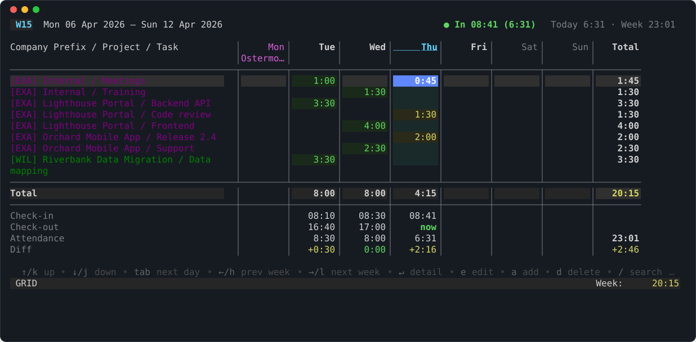
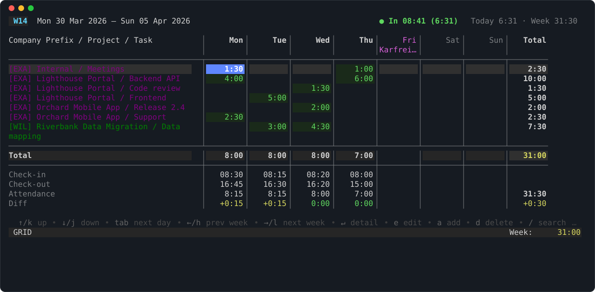
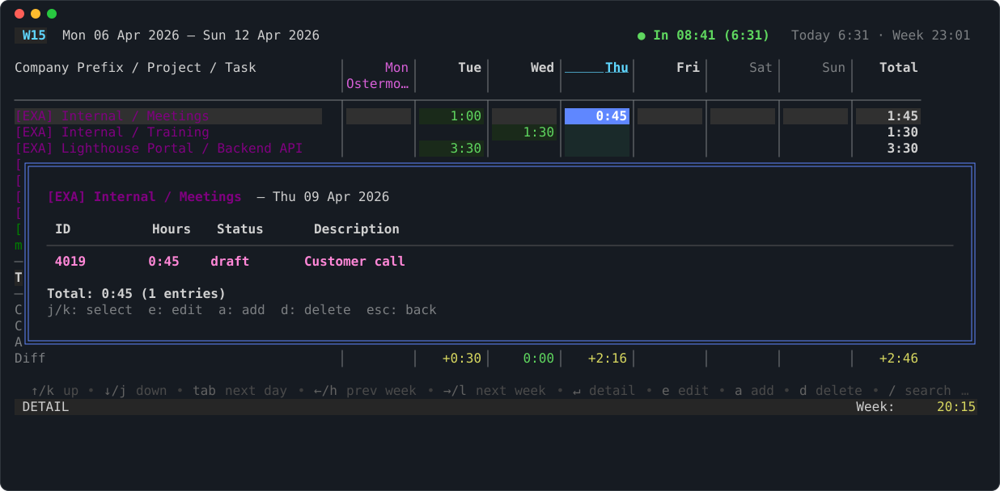
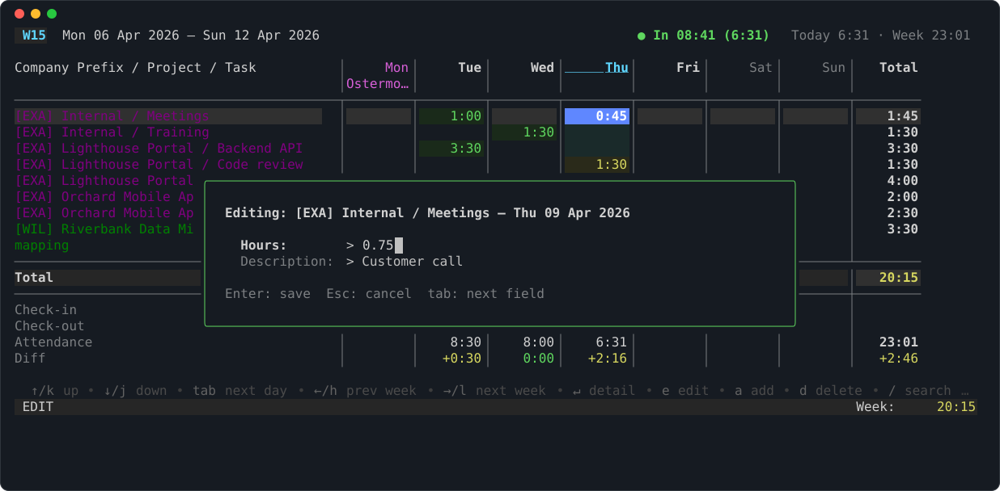
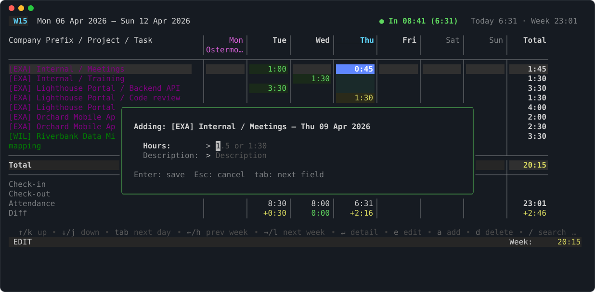
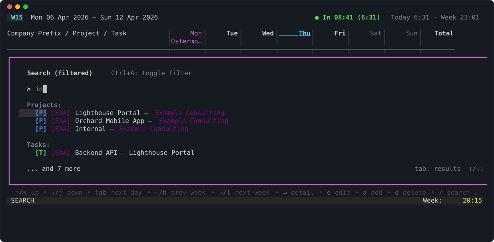
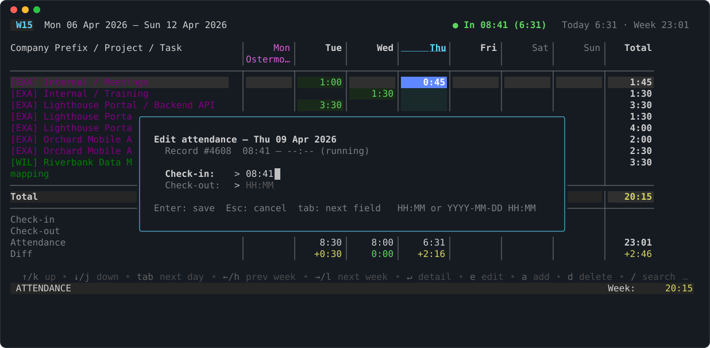
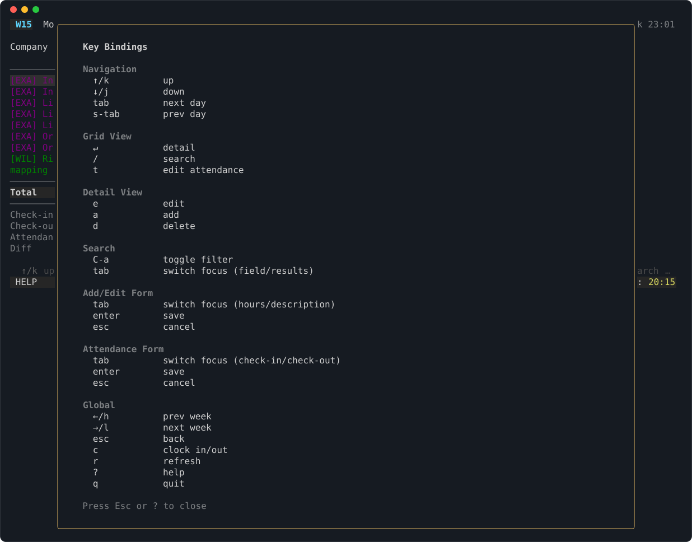

# A tour of the TUI

In this tutorial you walk through the TUI: the weekly grid, the detail view,
the add and edit forms, the search and the attendance form. The screenshots
come from the demo data of [Try it offline](10-try-it-offline.md); with that
setup you can press the same keys and get the same screens.

```sh
odoo-work-cli tui --week 2026-W15
```

Without `--week` the TUI opens the current week.

## The weekly grid



- The **header** shows the ISO week and its dates, the clock state
  (`● In 08:41 (6:31)`: clocked in since 08:41, for 6:31 hours) and the
  attendance totals of today and the week.
- Each **row** is a project and task. The prefix (`[EXA]`) is the first three
  letters of the company, coloured per company if you configure
  [`company_colors`](../how-to/90-customise-tui.md). Rows booked last week
  appear too, so you can book on them again.
- Each **cell** is the hours of one day. Green, yellow and red follow the
  daily [hour limits](../reference/40-configuration.md#hours).
- Monday is a public holiday (*Ostermontag*): its column is magenta. The
  holidays are German, per federal state.
- Below the totals, the **attendance rows** show check-in, check-out,
  attendance and the difference to the booked hours, per day. Thursday is
  still running (`now`); Tuesday has 30 minutes more attendance than bookings.

Move with the arrow keys or ++h++ ++j++ ++k++ ++l++: up and down change the
row, ++tab++ and ++shift+tab++ change the day, ++left++ and ++right++ change
the week. The cursor starts on today.

Press ++h++ once to see the previous week, with Good Friday as a holiday:



Press ++l++ to come back.

## The detail view

Put the cursor on the cell *Internal / Meetings* on Thursday and press
++enter++:



The detail view lists every entry of that cell with its ID, hours, status and
description. ++j++ and ++k++ select an entry.

## Edit an entry

In the detail view press ++e++:



Change the hours (`0:45`, `0.75`) or the description. ++tab++ switches the
field, ++enter++ saves, ++esc++ cancels. The grid reloads from Odoo after
saving.

## Add an entry

In the detail view press ++a++ instead:



The new entry gets the project, task and day of the selected cell. ++d++ in
the detail view deletes the selected entry, without asking first.

## Add a row with search

To book on a project or task that has no row yet, press ++slash++ in the grid
and type:



The list filters as you type. ++tab++ moves the focus to the list, ++enter++
adds the selected project or task as a new row. ++ctrl+a++ toggles the
[filters](../reference/40-configuration.md#models) from your config.

## Fix the attendance

Press ++t++ on any day to edit its attendance record:



Today has one running record: the check-out is empty. Fill it in to close the
record, or change the check-in. Times are `HH:MM`, or `YYYY-MM-DD HH:MM` for an
overnight shift. This writes `hr.attendance` directly and needs extra rights;
see [Clock in and out](../how-to/30-clock-in-out.md#permissions).

++c++ in the grid clocks you in or out, right now.

## Help

Press ++question++ for every key binding, grouped by view:



++esc++ closes it, ++q++ quits the TUI.

## Next

- All keys and how to rebind them: [TUI keys and views](../reference/50-tui-keys.md).
- Colours, hour limits and holidays: [Customise the TUI](../how-to/90-customise-tui.md).
