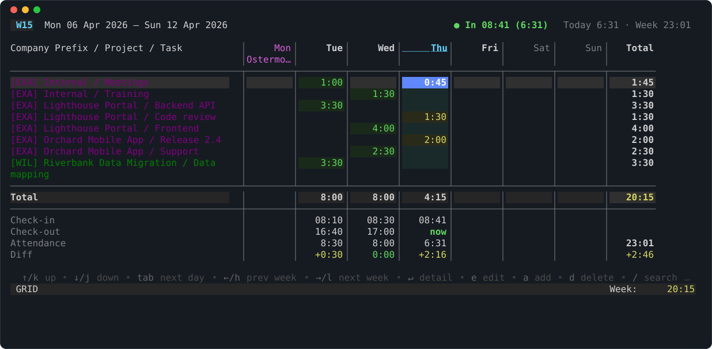

# odoo-work-cli

Book Odoo 17 timesheets and attendance from the terminal: a CLI for scripts
and coding agents, and a TUI for the weekly grid.

**Documentation: <https://seletz.github.io/odoo-work-cli/>**



## Features

- **Timesheets:** list, add, update and delete entries; `--dry-run` previews a write
- **Attendance:** clock in/out, also for non-admin users and with 2FA (TOTP);
  backdate, fix or add records for a forgotten day
- **TUI:** weekly grid with holidays, colour-coded totals, attendance per day,
  search, inline add/edit, configurable keys
- **For scripts and agents:** `--json`/`--format jsonl` output with JSON
  Schemas, stable error kinds, `llm --skill` guide
- **Offline:** a built-in fake backend runs every command without Odoo

## Install

```bash
brew tap seletz/tap
brew install odoo-work-cli
```

Update with `brew update && brew upgrade odoo-work-cli`. Release binaries and
`go install`: see [Install and update](https://seletz.github.io/odoo-work-cli/how-to/10-install-and-update/).

## Quick start

```bash
odoo-work-cli config install          # then set url, database, username
export ODOO_PASSWORD="your-api-key"   # the Odoo API key, not your password
odoo-work-cli whoami
odoo-work-cli tui
```

Step by step: [Your first booking](https://seletz.github.io/odoo-work-cli/tutorials/20-first-booking/).
Without an Odoo server: [Try it offline](https://seletz.github.io/odoo-work-cli/tutorials/10-try-it-offline/).

## Documentation

| | |
| --- | --- |
| [Tutorials](https://seletz.github.io/odoo-work-cli/tutorials/) | try it offline, first booking, TUI tour |
| [How-to guides](https://seletz.github.io/odoo-work-cli/how-to/) | book time, clock in/out, JSON output, agents, MCP, troubleshooting |
| [Reference](https://seletz.github.io/odoo-work-cli/reference/) | every command and flag, JSON output, error kinds, configuration, TUI keys |
| [Explanation](https://seletz.github.io/odoo-work-cli/explanation/) | config layering, secrets, the two transports, the attendance model |

## Development

### Prerequisites

- [Go](https://go.dev/) 1.21+
- [mise](https://mise.jdx.dev/) for task running and tool management
- [1Password CLI](https://developer.1password.com/docs/cli/) (`op`) — optional, for `[op_secrets]` resolution

### Mise Tasks

```bash
# Install tools via mise
mise install

# Build
mise run build

# Run tests
mise run test

# Lint
mise run lint
```

### Documentation

The site under [`docs/`](docs/) is built with [Zensical](https://zensical.org/)
(pinned in `pyproject.toml`, installed by `uv`) and deployed to GitHub Pages
from `develop` by `.github/workflows/docs.yml`.

```bash
mise run docs:serve              # live preview
mise run docs:build              # strict build into site/
mise run docs:screenshots        # TUI screenshots, CLI samples, demo state
mise run docs:reference          # command reference: site pages and man pages (man/man1)
mise run docs:check              # fail if anything generated is stale (CI runs this)
```

Screenshots and CLI samples are rendered by `tools/docsgen` from the fake
backend with a fixed demo state and clock (2026-W15), so they are
reproducible. A change to the TUI, a command's output or its help text makes
`docs:check` fail until you regenerate and commit.

### Dev environment setup

> [!IMPORTANT]
> Local development and automated tests target the **dev** Odoo environment
> **only**. The test and prod environments must never be touched by local
> development or tests.

Dev credentials live in a single 1Password item and flow into the project in
two ways:

- **`.env` for mise tasks** — [`1p.env`](1p.env) is a 1Password template
  containing `op://` references. `mise run prepare_env` runs `op inject` on it
  to generate a local `.env`, which mise auto-loads for every task (including
  `mise run run -- ...` and the `odoo:*` tasks below).
- **`[op_secrets]` for the CLI** — the checked-in
  [`.odoo-work-cli.toml`](.odoo-work-cli.toml) resolves the same 1Password
  item at runtime, so running the built binary from the repo directory picks
  up dev credentials automatically.

Both expect a 1Password item with the fields `url`, `database-name`, `login`,
`api-key`, `password`, and `totp_secret`.

Bootstrap tasks:

```bash
mise run prepare_env          # generate .env from 1p.env via op inject
mise run odoo:create-api-key  # create an XML-RPC API key via the web login
                              # flow (handles 2FA) and write it back to 1Password
mise run odoo:add-test-data   # idempotent: seed the dev db with the modules,
                              # company, project, tasks and employee the
                              # checked-in config filters expect
mise run odoo:ensure-test-user # idempotent: provision the non-admin test
                              # user (see below)
mise run odoo:prepare-db      # all of the above in order — bootstraps a
                              # freshly recreated dev db in one command
```

When the dev database is recreated ("nuked"), all previously issued API keys
are gone. `mise run odoo:prepare-db` fixes that end-to-end: it creates a new
API key, refreshes `.env`, and re-seeds the test data.

### Non-admin test user

The CLI user provisioned above is an **administrator**, so ACL/permission
bugs never surface with it — [#40](https://github.com/seletz/odoo-work-cli/issues/40)
(`whoami` faulting for regular users) is exactly the class of bug that hides.
The bootstrap therefore also provisions a permanent **non-admin** test user
(issue [#55](https://github.com/seletz/odoo-work-cli/issues/55)):

- `mise run odoo:ensure-test-user` — idempotent; creates/repairs a user with
  login `test-user`, the regular-employee groups only (**Internal User**,
  **Project/User**, **Timesheets/User: own timesheets only** — verified not
  to be in Administration/Settings), and a linked `hr.employee` record.
  Strictly Internal-User-only does not work: Odoo denies reading
  `account.analytic.line` / `project.project` without the per-app user
  groups every real employee has. A fresh random
  password is set on every run and written to the `test-user-password` field
  of the "ODOO Work CLI" 1Password item (printed once to stdout instead if
  the `op` CLI is unavailable). The user has no 2FA, so XML-RPC accepts the
  plain password — no API key needed.
- `mise run odoo:run-as-user -- <args...>` — run any CLI/TUI command as that
  user, e.g. `mise run odoo:run-as-user -- whoami`. Overrides
  `ODOO_USERNAME`/`ODOO_PASSWORD`/`ODOO_WEB_PASSWORD` for the invocation
  (password read from 1Password, or from `ODOO_TEST_USER_PASSWORD` if set).
- `mise run odoo:smoke-test-user` — smoke check: runs `whoami`,
  `clock status` and `entries` as the non-admin user and fails loudly on
  ACL faults. Run it after changes that touch Odoo model reads/writes.

### Pre-upgrade check: web-login version-drift canary

The 2FA web session used by `clock in|out` authenticates through Odoo's HTML
login flow (`/web/login` → `/web/login/totp`) and therefore encodes
web-controller internals that a new Odoo version may change
([#57](https://github.com/seletz/odoo-work-cli/issues/57)):

- `GET /web/login?db=<db>` binds the session and serves a `csrf_token` input
- `POST /web/login` accepts `csrf_token`, `login`, `password`, `redirect`
- 303 redirect = accepted (to `/web/login/totp` when 2FA is pending),
  200 = rejected
- `POST /web/login/totp` accepts `csrf_token`, `totp_token`

```bash
mise run odoo:login-canary
```

exercises the full flow against the **dev** instance — login, TOTP challenge,
and a session-authenticated JSON-RPC call — and on failure names the encoded
assumption that broke (e.g. "login page markup may have changed; check the
Odoo version").

**This is the mandatory pre-upgrade check.** Dev receives new Odoo versions
first, so run the canary against dev **before any Odoo upgrade reaches test
or prod**. If it fails, `clock in|out` (and `mise run odoo:create-api-key`,
which mirrors the same flow) will break on that Odoo version.

**Known limitation:** `clock in|out` currently fails against multi-database
servers — the web session is not reliably bound to the requested database.
Tracked in [#48](https://github.com/seletz/odoo-work-cli/issues/48).

## Releasing

Releases are managed via `mise run release` and built by
[GoReleaser](https://goreleaser.com/) in GitHub Actions.

### Creating a release

```bash
mise run release
```

This will:

1. Show the current version (latest `v*` tag, or `v0.0.0` if none)
2. Prompt for bump type (patch / minor / major)
3. Create an annotated git tag
4. Push the tag to origin

GoReleaser then automatically:

- Cross-compiles for macOS (amd64, arm64), Linux (amd64, arm64), and Windows (amd64)
- Packages binaries as `.tar.gz` (Unix) or `.zip` (Windows)
- Creates a GitHub Release with all artifacts and SHA-256 checksums
- Updates the [Homebrew tap](https://github.com/seletz/homebrew-tap) cask so `brew upgrade` picks up the new version

### Local testing

```bash
mise run goreleaser-check       # validate .goreleaser.yml
mise run goreleaser-snapshot    # full build without publishing
```

### Version embedding

The build injects the version via `-ldflags`:

```bash
mise run build
./odoo-work-cli --version
```
